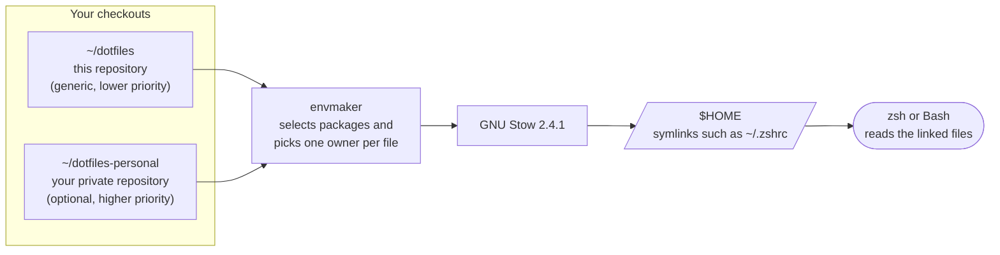
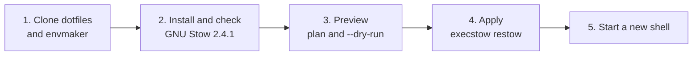
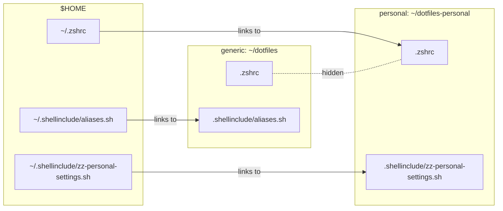
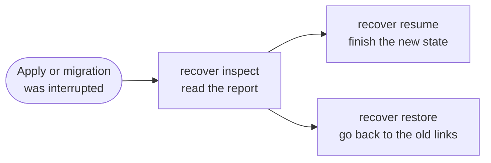

# Dotfiles

A shell-first configuration tree for zsh and Bash: prompt, aliases, shell
helpers, PATH handling, and optional settings for many command-line tools.
It is applied with [envmaker](https://github.com/sasuw/envmaker), which links
the right packages into your home directory with GNU Stow.

You use this repository as the shared, generic layer. Your own settings go
into a second, private repository that envmaker stacks on top, so you can
update the generic layer without losing your changes.

## How it fits together



The tree uses envmaker's layout:

| Directory                    | What it holds                                     | When it is linked                    |
| ---------------------------- | ------------------------------------------------- | ------------------------------------ |
| `common/`                    | zsh, Bash, aliases, shell helpers, XDG settings   | Always                               |
| `parts/application/COMMAND/` | Settings for one command-line tool                | When `COMMAND` is installed          |
| `parts/ostype/OS/`           | Settings for `linux`, `macos` or `bsd`            | On that operating system             |
| `parts/NAME/`                | Larger optional setups, such as `nvm` or `golang` | When the script `rules/NAME` exits 0 |

When both repositories provide the same file, for example `~/.zshrc`, your
personal copy wins as a whole. See
[Personal configuration](#add-your-personal-configuration).

Git uses one shared `~/.gitconfig` from this repository. It loads optional
`~/.gitconfig-private`, `~/.gitconfig-company` and `~/.gitconfig-projects`
files, so higher layers can add settings without replacing the shared file.
The shared config sets `user.useConfigOnly`; put author identities in the
appropriate private include. Git refuses commits where no identity applies.

## Install

### What you need

- Git, zsh, Perl 5.16 or newer, and `hostname`. Bash is optional; it gets a
  smaller setup than zsh (see [After the install](#after-the-install)).
- Standard Unix tools, including `find`, `readlink` and `xargs`. Some helper
  functions also use `realpath` and `sort`.
- GNU Stow 2.4.1 installed at exactly `/opt/stow-2.4.1/bin/stow`, together
  with its matching Perl modules. A `stow` found elsewhere on `PATH` is not
  used.
- For the checks only: Python 3 and Gitleaks 8.16.0.

Linux is tested. macOS and FreeBSD have not been verified yet and may need GNU
versions of some tools.

Try the first install in a disposable user account, and read `common/`,
`parts/` and `rules/` before you apply anything. Installed applications
select their settings automatically. Rule scripts and the `hostname` command
run even during a preview, so only use sources you trust. The tree needs no
package manager and no secret store; optional packages need their
applications.

### Steps



1. Clone this repository and envmaker:

   ```bash
   git clone https://github.com/sasuw/dotfiles "$HOME/dotfiles"
   git clone https://github.com/sasuw/envmaker "$HOME/envmaker"
   export DOTFILE_DIR="$HOME/dotfiles"
   ```

   `DOTFILE_DIR` names this generic checkout. Its default is `$HOME/dotfiles`.

2. Install GNU Stow 2.4.1 under `/opt` as described in envmaker's
   [Stow prerequisite guide](https://github.com/sasuw/envmaker/blob/02a190aff0b9de7fb8e04d7c081d401f830a787d/docs/prerequisites.md).
   In short: download and verify `stow-2.4.1.tar.gz` from GNU, then in the
   extracted source run:

   ```bash
   ./configure --prefix=/opt/stow-2.4.1
   make
   sudo make install
   ```

   Only the last command needs administrator rights. Then check that the
   executable and its modules match. envmaker runs Stow with the Perl named on
   the first line of the Stow executable, so run the probe with that Perl:

   ```bash
   cd "$HOME/envmaker"
   /opt/stow-2.4.1/bin/stow --version
   head -n 1 /opt/stow-2.4.1/bin/stow
   # Replace /usr/bin/perl with the interpreter that the previous line printed;
   # for "#!/usr/bin/env perl", use perl.
   /usr/bin/perl bin/stow_probe.pl /opt/stow-2.4.1/bin/stow 2.4.1
   ```

   The probe prints JSON. It must report version `2.4.1` and an existing
   `Stow.pm`.

3. Preview what will be linked. Use a one-source stack even if you have no
   personal repository yet; you can add one later without migrating links:

   ```bash
   bash "$HOME/envmaker/envmaker.sh" --source generic="$DOTFILE_DIR" listdirs
   bash "$HOME/envmaker/envmaker.sh" --source generic="$DOTFILE_DIR" plan
   bash "$HOME/envmaker/envmaker.sh" --source generic="$DOTFILE_DIR" --dry-run execstow restow
   ```

   `listdirs` shows the selected directories, and `plan` shows which file
   each link will point to. The preview checks selection and ownership but
   does not run the full Stow simulation, so a successful preview is not a
   guarantee. Files you edit between preview and apply are used as they are
   at apply time.

4. Apply, then list the links envmaker recorded:

   ```bash
   bash "$HOME/envmaker/envmaker.sh" --source generic="$DOTFILE_DIR" execstow restow
   bash "$HOME/envmaker/envmaker.sh" ls
   ```

   envmaker refuses to replace existing files or links it does not own.
   Move such a file out of the way yourself, then apply again. Equal content
   does not count as ownership. If your home already has links from an older
   Stow setup, [migrate them](#move-from-existing-stow-links) instead. Do
   not run plain `stow` to get around a refusal.

5. Start a new shell:

   ```bash
   exec zsh
   ```

   Bash users run `exec bash` instead.

### After the install

- zsh loads everything in `~/.shellinclude/`: first all `*.sh` files, then all
  `*.zsh` files, each in name order. Bash does not read that directory; it
  loads only `00-personal-root.sh`, `01-personal-env.sh`, `java-exports.sh`
  and the Maven includes from it. The helper scripts below and
  `zz-personal-settings.sh` therefore affect zsh only.
- The SSH shell include resets terminal colors after an interactive `ssh`
  command exits. Open a new zsh after restowing to load the `ssh` function.
- `.zshenv` loads `.zshvars`, `.zshversions`, `.bin/common.sh` and
  `.bin/lib/dotfiles_root.sh`. If your personal repository overrides one of
  these files, keep it compatible with the others.
- Put early personal environment settings into
  `~/.shellinclude/01-personal-env.sh`. Both shells load it before the prompt
  is set up.
- Interactive zsh adds `~/.bin` to `PATH`. In other shells, call
  `"$HOME/.bin/command"` or set `PATH` yourself. `bash -c` inherits its
  parent's `PATH`.
- After you add files, preview and run `execstow restow` again before you
  reload the shell. After editing files that are already linked, a new shell
  is enough.
- If your generic checkout is not at `$HOME/dotfiles`, set `DOTFILE_DIR` in
  your environment or in `~/.shellinclude/00-personal-root.sh`. A value from
  the environment wins. Paths with spaces work. zsh exports the result, so a
  shell started from another one keeps the old value; change
  `00-personal-root.sh` and then open a new terminal.
- Tool versions are pinned in the tree: Stow and JMeter in
  `common/zsh/.zshversions`, LEGO in `common/zsh/.zshvars`. The rule scripts
  read the pins from their own repository, so they work before anything is
  linked. If your personal repository overrides one of these files, the
  generic rules still use the generic pins.
- The optional `stow`, `jmeter` and `lego` parts expect
  `/opt/stow-VERSION`, `/opt/apache-jmeter-VERSION` and
  `/opt/lego_vVERSION_OS_ARCH/lego`. Set `STOW_INSTALL_ROOT`,
  `JMETER_INSTALL_ROOT` or `LEGO_INSTALL_ROOT` to use another directory
  instead of `/opt`, and export it both where you run envmaker and in your
  shell, for example in `01-personal-env.sh`. `STOW_INSTALL_ROOT` only changes
  the Stow that the `stow` part adds to `PATH`; envmaker itself always uses
  `/opt/stow-2.4.1/bin/stow`.
- In zsh, the prompt uses plain spacing when the character set is not UTF-8.
  The Bash prompt always uses a thin Unicode space and needs a UTF-8 locale.

## Add your personal configuration



1. Create an empty private repository with the same layout:

   ```bash
   bash "$HOME/envmaker/envmaker.sh" init "$HOME/dotfiles-personal"
   ```

   This runs `git init` locally. It creates no remote and publishes nothing.
   Keep credentials out of Git.

2. Register both repositories, lowest priority first. Keep a copy of any
   existing configuration, then put these lines into
   `${XDG_CONFIG_HOME:-$HOME/.config}/dotfiletracker/config` (create the
   directory if needed):

   ```text
   source.generic="$HOME/dotfiles"
   source.personal="$HOME/dotfiles-personal"
   ```

   Remove an old `dotfiles_dir` line; envmaker refuses a file that has both.
   The file is data, not shell code: only a leading `~`, `$HOME` or `${HOME}`
   is expanded. To keep only the generic layer, keep just the first line.
   Every registered directory must exist.

3. Add packages under `common/`, `parts/` and `rules/` of your personal
   repository, as in this one. Then preview and apply the stack:

   ```bash
   bash "$HOME/envmaker/envmaker.sh" listdirs
   bash "$HOME/envmaker/envmaker.sh" plan
   bash "$HOME/envmaker/envmaker.sh" explain .zshrc
   bash "$HOME/envmaker/envmaker.sh" --dry-run execstow restow
   bash "$HOME/envmaker/envmaker.sh" execstow restow
   bash "$HOME/envmaker/envmaker.sh" ls
   exec zsh
   ```

   `explain` shows which repository provides a file and which copies it
   hides. `ls` shows the recorded links without looking at the repositories
   again.

   For a single run, repeated `--source ID=PATH` options replace the whole
   configured list, in order:

   ```bash
   bash "$HOME/envmaker/envmaker.sh" \
     --source generic="$DOTFILE_DIR" \
     --source personal="$HOME/dotfiles-personal" explain .zshrc
   ```

   `--source` cannot be combined with `--dotfiles-dir`, which selects
   envmaker's single-repository mode.

### Which copy wins

- The higher repository wins a whole file, even if both copies are
  identical. If you copied a file into your personal repository and never
  changed it, later generic updates to that file do not reach you.
- Files are not merged. Editing `~/.zshrc` edits the copy that currently wins.
  An editor that replaces the link with a regular file makes envmaker refuse
  the next apply until you move that file.
- Delete, ignore or deselect your personal copy, and the next apply links the
  generic one again. An empty personal repository changes nothing.
- Removing a repository from the list removes its recorded links on the next
  apply. This is not a general cleanup of your home directory.
- Two copies of the same file in one repository, or a file in one repository
  where the other has a directory, are errors. Package names do not affect
  priority.
- Rules and hooks belong to their own repository. A rule in one repository
  never disables a package in the other. Hooks run in repository order; hooks
  with the same name run in both.
- For personal zsh settings, use
  `common/personal/.shellinclude/zz-personal-settings.sh` in your personal
  repository. Its name makes it load after the generic `*.sh` includes, but
  before the generic `*.zsh` includes and before the rest of `.zshrc`. Bash
  does not load it.

### Helper scripts that write configuration

`add_to_path.sh` adds a directory to `PATH`, and `add_function_for_cmd.sh`
adds a shell function. With the stack registered, tell them which repository
to change:

```sh
add_to_path.sh --source personal --no-git "$HOME/tools/bin"
add_function_for_cmd.sh --source personal --no-git show_root 'git rev-parse --show-toplevel'
```

- `--source personal` writes into the root of `source.personal`.
  `add_to_path.sh` uses `common/shellutil/.shellinclude/zz-personal-paths.sh`
  there if it exists, otherwise `path_additions.sh` in the same directory.
  `add_function_for_cmd.sh` uses
  `common/alias/.shellinclude/zz-personal-aliases.sh`, otherwise `aliases.sh`.
  If neither exists, the helper refuses. Create and commit that file first,
  or pass `--file` with a file inside that repository.
- Without a registered stack, use `--layer-root "$HOME/dotfiles"` instead of
  `--source`. `--source` and `--layer-root` cannot be combined. With both
  `--layer-root` and `--file`, the file must be inside that root and belong
  to its Git repository.
- `--dry-run` shows the change. Without `--no-git`, the helper stages,
  commits and pushes the changed file. Before that it checks that the file is
  tracked and unchanged, that the branch is not detached and that a push
  remote exists; a `--dry-run` without `--no-git` runs these checks too.
- `add_function_for_cmd.sh` refuses a function name that its own repository
  or any registered repository already defines in its shell startup files or
  includes, and a name that is already a zsh command or builtin unless you
  pass `--force`. It refuses to run while the registry is invalid, whichever
  destination option you use. The helpers never pick a repository on their
  own.

For a new application include, run
`dotfiles_add_application_config <layer-root> <application-name> [config-name]`
in an interactive zsh. It creates
`parts/application/APP/CONFIG/.shellinclude/CONFIG_APP.sh`, or `APP.sh` when
`CONFIG` equals `APP` (`CONFIG` defaults to `default`). It never overwrites a
file and does not touch Git. The repository
needs a `parts/application` directory; without it the function only reports
"Invalid destination or configuration name".

## Move from existing Stow links

If your home already has links from plain Stow or from envmaker's
single-repository mode, register the repository that owns them first, as
above. A normal apply refuses to take over such links. Then migrate them.
Replace `generic` with the ID of the repository that owns the old links:

```bash
bash "$HOME/envmaker/envmaker.sh" --yes --dry-run migrate --from generic
bash "$HOME/envmaker/envmaker.sh" --yes migrate --from generic
bash "$HOME/envmaker/envmaker.sh" ls
```

Only exact relative Stow links into selected packages of that repository
qualify; equal content or an absolute link does not. The switch is not
atomic: if it stops after the old links were removed, recover as described
below. After a successful migration, use the normal preview and
`execstow restow` for updates.

## Recover an interrupted operation



Keep `HOME` and `XDG_STATE_HOME` as they were for the interrupted run, and
read the report first:

```bash
bash "$HOME/envmaker/envmaker.sh" recover inspect
```

Then choose **one** action:

```bash
# Finish the recorded new state (needs the recorded repositories):
bash "$HOME/envmaker/envmaker.sh" recover resume

# Or put back the previous links or the original migrated links:
bash "$HOME/envmaker/envmaker.sh" recover restore
```

`restore` also works when a repository is missing; the restored links then
point nowhere until it is back. Recovery refuses to touch files that someone
replaced and refuses while a recorded process is still running. Do not delete
envmaker's journal, state or lock files, and do not rerun a failed operation
blindly. envmaker's
[state and recovery reference](https://github.com/sasuw/envmaker/blob/02a190aff0b9de7fb8e04d7c081d401f830a787d/docs/overlay_state.md)
and [migration guide](https://github.com/sasuw/envmaker/blob/02a190aff0b9de7fb8e04d7c081d401f830a787d/docs/migrate_overlay.md)
have the details.

## Checks and license

Before you send a change, run:

```bash
bash tests/add_to_path_test.sh
python3 -I tests/explicit_destinations_test.py
python3 -I tests/startup_discovery_test.py
python3 -I scripts/scan_public.py --root .
```

The tests cover the PATH helper, the helpers' destination options, and
`DOTFILE_DIR` and version-pin handling. The scan needs Gitleaks 8.16.0 and is
the only check CI runs; see the [scan policy](docs/public_scan.md). Check changed shell files with `bash -n`
and `shellcheck`, or `zsh -n` for zsh files. There is nothing to compile.
Before each release, the maintainers also run a private check for names and
terms that must not be published.

The original content is MIT licensed; see [LICENSE](LICENSE). The owner has
confirmed the right to redistribute it. External programs and plugins keep
their own licenses; that confirmation does not cover dependencies you install
separately.
